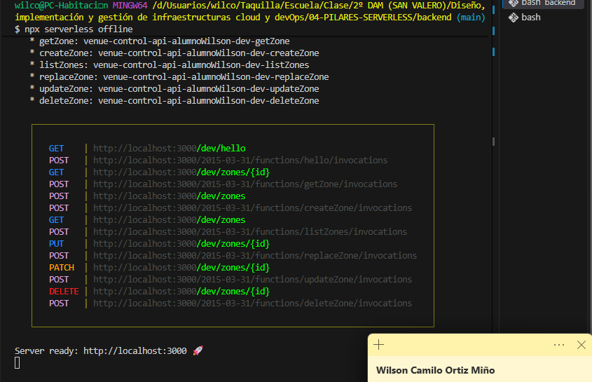
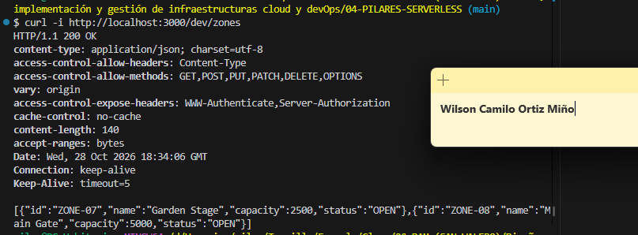
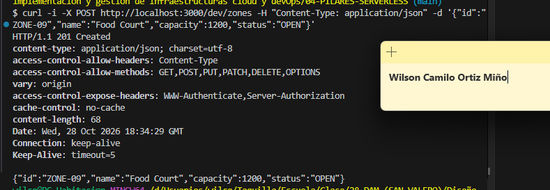
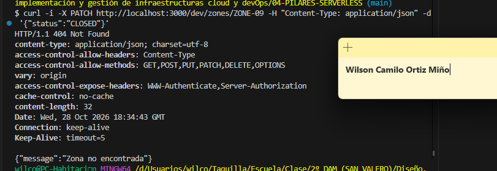

# Venue Control

App móvil interna para gestionar las zonas/espacios operativos de un gran festival. Entrenamiento evaluable de la unidad 04 · Pilares Serverless (2º DAM).

- **Autor:** `Wilson Camilo Ortiz Miño` · **Código de alumno:** `alumnoWilson`
- **Backend:** Node.js 22 + TypeScript + Serverless Framework 4 (API Gateway + Lambda).
- **Mobile:** Expo / React Native + TypeScript (también en navegador con React Native Web).
- **Despliegue:** AWS Academy (Learner Lab), región `us-east-1`.

## Arquitectura

```
React Native  →  HTTP  →  API Gateway  →  Lambda (Node.js)  →  Respuesta JSON
                                              │
                                              └─→  Logs (CloudWatch)
```

- La app llama a la API con `fetch`, siempre a través de la capa HTTP `mobile/src/api.ts`, separada de la interfaz.
- API Gateway enruta cada método y ruta a una Lambda. El `{id}` de la URL llega al handler en `event.pathParameters.id`, y el JSON de la petición llega como texto en `event.body` (se convierte con `JSON.parse`).
- Cada handler devuelve `statusCode`, cabeceras (con CORS) y un `body` JSON.
- Cada petición escribe en los logs una línea con método, ruta, parámetros y body.

## Estructura del repositorio

```
backend/
  serverless.yml
  tsconfig.json
  package.json
  src/
    hello.ts
    zones/
      model.ts      tipos, catálogo en memoria, validación y helpers de respuesta
      list.ts       GET    /zones
      get.ts        GET    /zones/{id}
      create.ts     POST   /zones
      replace.ts    PUT    /zones/{id}
      update.ts     PATCH  /zones/{id}
      delete.ts     DELETE /zones/{id}
  dist/             JS compilado (generado, no se versiona)
mobile/
  App.tsx           interfaz con cuatro vistas: Listado, Detalle, Nuevo y Editar
  app.json
  src/
    types.ts        tipos de Zone
    api.ts          capa HTTP
```

## Contrato de la API

```json
{ "id": "ZONE-07", "name": "Garden Stage", "capacity": 2500, "status": "OPEN" }
```

`status` admite `OPEN`, `FULL` o `CLOSED`.

| Método | Ruta          | Descripción                    | Respuestas    |
|--------|---------------|--------------------------------|---------------|
| GET    | `/zones`      | Lista todas las zonas          | 200           |
| GET    | `/zones/{id}` | Devuelve una zona              | 200, 404      |
| POST   | `/zones`      | Crea una zona                  | 201, 400, 409 |
| PUT    | `/zones/{id}` | Reemplaza la zona completa     | 200, 400, 404 |
| PATCH  | `/zones/{id}` | Modifica solo los campos dados | 200, 400, 404 |
| DELETE | `/zones/{id}` | Elimina la zona                | 200, 404      |

Los errores devuelven `{ "message": "..." }`.

## Ejecución local

Requisitos: Node.js 22 y npm.

### Backend

```bash
cd backend
npm install
export STUDENT_CODE=alumnoWilson
export AWS_REGION=us-east-1
export LAMBDA_ROLE_ARN=<ARN del LabRole>
npm run typecheck
npm run build
npx serverless offline
```

Las rutas quedan en `http://localhost:3000/dev/zones`.

> `serverless.yml` lee `STUDENT_CODE`, `AWS_REGION` y `LAMBDA_ROLE_ARN` del entorno, así que hay que exportarlas incluso en local.

Prueba rápida:

```bash
curl -i http://localhost:3000/dev/zones
curl -i -X POST http://localhost:3000/dev/zones -H "Content-Type: application/json" -d '{"id":"ZONE-09","name":"Food Court","capacity":1200,"status":"OPEN"}'
curl -i -X PATCH http://localhost:3000/dev/zones/ZONE-09 -H "Content-Type: application/json" -d '{"status":"CLOSED"}'
```

### App móvil

```bash
cd mobile
npm install
EXPO_PUBLIC_API_URL=http://localhost:3000/dev npx expo start --web
```

- Navegador: `http://localhost:3000/dev`
- Emulador Android: `http://10.0.2.2:3000/dev`
- Móvil físico: `http://<IP de tu PC>:3000/dev`

## Despliegue en AWS

1. Iniciar el laboratorio en AWS Academy y copiar las credenciales temporales (AWS Details → AWS CLI) al perfil `academy` de `~/.aws/credentials`. **No se guardan en el repositorio.**
2. Preparar la terminal y comprobar la identidad:

   ```bash
   export AWS_PROFILE=academy
   export AWS_REGION=us-east-1
   export AWS_DEFAULT_REGION="$AWS_REGION"
   export STUDENT_CODE=alumnoWilson
   export LAMBDA_ROLE_ARN=<ARN del LabRole>
   aws sts get-caller-identity --profile academy
   ```

3. Desplegar:

   ```bash
   cd backend
   npm run build
   npx serverless deploy --stage dev --region "$AWS_REGION"
   ```

   `serverless deploy` crea un stack de CloudFormation con las funciones Lambda, la API REST de API Gateway y los grupos de logs. Se reutiliza `LabRole` porque en Academy no se pueden crear roles.

4. Probar la URL base (hasta `/dev`) con Thunder Client y curl.
5. Apuntar la app a AWS:

   ```bash
   cd mobile
   EXPO_PUBLIC_API_URL=<URL base de AWS> npx expo start --web
   ```

6. Ver los logs de una invocación provocada desde la app:

   ```bash
   cd backend
   npx serverless logs -f listZones --stage dev --region "$AWS_REGION"
   ```

## Decisiones de diseño

- **Catálogo en memoria.** Las zonas viven en un array del módulo. Se pierde al reiniciar `serverless-offline` y en un cold start de Lambda, y cada instancia puede tener un estado distinto. Se admite en el entrenamiento; una versión real usaría DynamoDB.
- **PUT vs PATCH.** PUT reemplaza la zona completa y exige los cuatro campos. PATCH solo cambia los campos recibidos y valida únicamente esos.
- **Validación.** El body se procesa con `JSON.parse` protegido: JSON inválido o vacío devuelve 400, no 500. `capacity` debe ser un entero mayor que 0 y `status` uno de los valores permitidos.
- **Códigos de estado.** 201 al crear, 404 si el id no existe, 409 si el id ya existe.
- **DELETE devuelve 200 con cuerpo** (no 204) para que el cliente lea siempre JSON.
- **CORS** habilitado para poder usar la app en el navegador.
- **Capas separadas.** En el backend, un handler por operación y la lógica común en `model.ts`. En la app, la UI no llama a `fetch`: lo hace `api.ts`.
- **URL configurable.** La app lee `EXPO_PUBLIC_API_URL`, así que pasar de local a cloud no exige cambiar código.
- **Probar la API antes que la app.** Cada cambio se valida con Thunder Client y curl; si la app falla, se sabe si el fallo está en la API o en el cliente.


## Limitaciones

- Los datos no persisten (catálogo en memoria).
- No hay autenticación: cualquiera con la URL puede llamar a la API.
- Las credenciales de AWS Academy caducan al terminar la sesión del lab, por lo que el endpoint puede dejar de estar disponible.

## Seguridad

El repositorio no contiene ninguna Access Key, Secret Key ni Session Token. `.gitignore` excluye `node_modules`, `dist`, `.serverless` y los archivos `.env*`. Comprobación antes de cada commit:

```bash
git grep -nE "AKIA|aws_secret|aws_session_token"
```

Debe salir vacío.

## Capturas

Captura/evidencia de serverless-offline con rutas.



Al menos tres operaciones reproducidas con curl:



