# Festival Control · Bloque 01
 
## Qué he construido

Una función Lambda en TypeScript (backend/src/hello.ts) que responde a GET /hello con estado 200 y un JSON. La he ejecutado en local con Serverless Framework y serverless-offline, y la ruta que he probado es http://localhost:3000/dev/hello. No he desplegado nada en AWS.
 
## Qué he comprendido

- Tipos del handler: APIGatewayProxyEvent tipa la entrada (el evento HTTP que recibe la función) y Promise<APIGatewayProxyResult> tipa la salida, que debe tener statusCode y body. Si, por ejemplo, statusCode fuera un string, el compilador daría error.

- Compilación: escribo src/hello.ts, tsc lo compila a dist/hello.js y el serverless.yml apunta a dist/hello.handler. Por eso npm start compila antes de arrancar Offline, y no se edita nunca dist a mano.

- Dónde sale EVENT RECIBIDO: el console.log se ejecuta en el proceso del backend, así que aparece en la terminal donde corre Offline. No viaja en la respuesta HTTP ni sale en curl.
 
## Qué he modificado

En hello.ts cambié el message a "Festival Control · equipo preparado" y añadí el campo service: "hello" dentro del JSON.stringify. Cambió el contenido del body, pero la URL se mantuvo igual porque la ruta y el método los define serverless.yml (path: hello, method: get), y ese archivo no lo toqué.
 
## Cómo lo he comprobado

curl: curl -i http://localhost:3000/dev/hello desde una segunda terminal devolvió HTTP 200 y el mismo JSON.
Log: en cada petición, la terminal del backend mostró una nueva línea EVENT RECIBIDO: con el evento.

Evidencia: [adjunto captura propia del curl y su log]

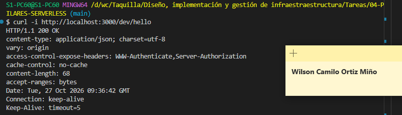

# Bloque 02
 
## Resultado

- Qué añadí al proyecto: Añadí un endpoint GET dinámico para consultar eventos mediante su identificador. Creé backend/src/getEvent.ts y configuré la ruta events/{id} en backend/serverless.yml, conservando el endpoint anterior /hello.

- Ruta o pantalla comprobada: GET http://localhost:3000/dev/events/EVT-104. También se propone comprobar EVT-205 y EVT-330 mediante curl.

- Estado y respuesta observados: Resultado esperado: 200 OK y una respuesta JSON con el identificador solicitado, el artista Neon Waves, el espacio Main Stage, la hora 22:30 y el estado CONFIRMED.
 
## Comprensión

- Recorrido del dato, explicado con mis palabras: El cliente envía una petición GET con el identificador en la URL. La ruta events/{id} permite recibir ese valor en event.pathParameters?.id. El handler comprueba que exista y construye una respuesta HTTP con el identificador y los datos del evento en formato JSON.

- Cambio guiado y resultado: Probé el uso de otro identificador, como EVT-330, sin modificar el código del handler. El resultado esperado es un 200 OK con el nuevo identificador y el resto de los datos simulados.

- Error encontrado y cómo lo resolví: Si aparece un error 404, comprobaré que el método sea GET y que la URL incluya /dev/events/{id}. Si aparece un error de TypeScript, revisaré el archivo y la línea indicados, corregiré el problema y repetiré npm run typecheck. Anotaré el error real si se produce alguno.
 
## Evidencias

- Captura o transcripción breve, sin credenciales:

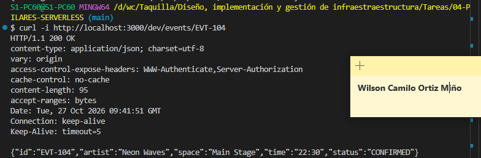

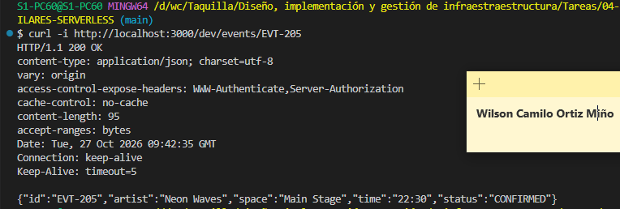

En la terminal del backend también debería aparecer GET evento: EVT-104. Sustituir esta evidencia esperada por la salida real obtenida al ejecutar la prueba.

- Limitaciones del ejercicio: Los datos del evento son simulados y están escritos directamente en el handler. Cualquier identificador no vacío devuelve los mismos datos, cambiando el campo id. Todavía no hay una búsqueda en un catálogo, una base de datos ni persistencia de eventos. El ejercicio se centra en comprender los parámetros de ruta y la respuesta HTTP.

# Bloque 03
 
## Resultado

- Qué añadí al proyecto: backend/src/createEvent.ts, un handler TypeScript que lee el body de un POST, lo valida y responde, y la función createEvent en serverless.yml (POST /events, con cors: true).

- Ruta o pantalla comprobada: POST http://localhost:3000/dev/events.

- Estado y respuesta observados: con un body válido, 201 y un JSON con id: "EVT-NEW" y los campos enviados (artist, space, time, status). Con un campo ausente, un JSON roto o valores inválidos, 400 con un mensaje explicativo.
 
## Comprensión

- Recorrido del dato, explicado con mis palabras: el cliente envía un objeto JSON en el body del POST. El handler lo recibe como texto en event.body, lo convierte con JSON.parse dentro de un try/catch (si la sintaxis es incorrecta, responde 400) y lo trata como unknown, porque la red puede traer cualquier cosa. Comprueba que sea un objeto, que artist y space sean textos no vacíos, que time tenga formato HH:mm y que status sea CONFIRMED o CANCELLED. Si todo es correcto, devuelve 201; si no, 400. TypeScript revisa mi código al compilar, pero la validación revisa los datos reales durante la ejecución, así que hacen falta las dos.

- Cambio guiado y resultado: repetí el POST válido con status: "CANCELLED" y obtuve 201. Después probé status: "PAUSED" y time: "29:80" en peticiones separadas y ambas devolvieron 400.

- Error encontrado y cómo lo resolví: [escribe aquí un error real que tuviste, por ejemplo un 404 por una URL mal escrita o un error de indentación en el YAML, y cómo lo solucionaste. Si no tuviste ninguno, indícalo.]
 
## Evidencias
- Captura o transcripción breve, sin credenciales:

POST valido:

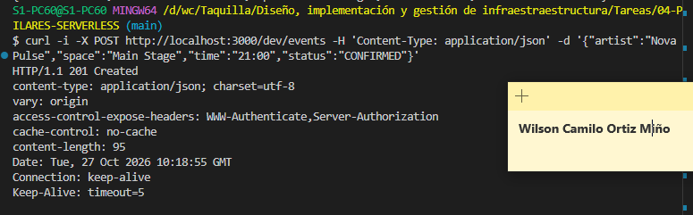

Campo ausente:

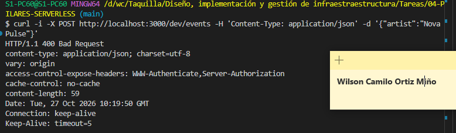

JSON roto:

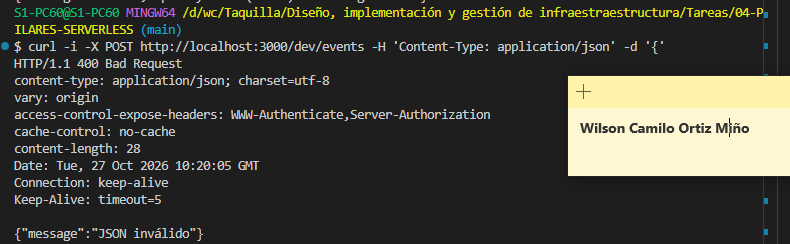

Comprobando el limite:

- Limitaciones del ejercicio: el 201 es una respuesta didáctica. El id EVT-NEW es fijo y no se guarda nada, así que un GET posterior no recupera lo enviado por POST (GET /events/EVT-NEW devuelve la ficha fija de Neon Waves). No hay base de datos ni persistencia, y todo se ha probado en local, sin desplegar en AWS.

# Bloque 04
 
## Resultado
- Qué añadí al proyecto: Un contrato HTTP completo sobre /events y /events/{id} con cinco métodos. Creé src/events/model.ts (tipos, catálogo fijo, json(), readBody() e isEventInput()), los handlers list.ts, get.ts, create.ts, replace.ts, update.ts y delete.ts, y actualicé serverless.yml para enlazar cada método con dist/events/*.handler manteniendo hello y las rutas acumuladas.

- Ruta o pantalla comprobada: Probé los cinco métodos con curl -i contra http://localhost:3000/dev/events y http://localhost:3000/dev/events/{id}. También verifiqué el preflight OPTIONS con cabeceras Origin, Access-Control-Request-Method y Access-Control-Request-Headers.

- Estado y respuesta observados: GET /events → 200 con los dos eventos (EVT-101, EVT-102); GET /events/EVT-101 → 200 con el evento; GET /events/NO-EXISTE → 404. POST → 201 con EVT-NEW; PUT /events/EVT-101 → 200 con operation: "REPLACED"; PATCH de status → 200 con changes.status: "CANCELLED" y operation: "UPDATED"; DELETE /events/EVT-102 → 200 con operation: "DELETED". OPTIONS respondió 2xx permitiendo el origen y POST, y los GET incluyeron Access-Control-Allow-Origin: *.
 
## Comprensión
- Recorrido del dato, explicado con mis palabras: El cliente HTTP envía método y ruta; API Gateway (Offline) los enruta al handler correspondiente de dist/events; el handler lee pathParameters o body, valida con readBody() e isEventInput() y responde con json(estado, valor). El catálogo catalog es fijo y nunca se muta, así que las escrituras solo devuelven un contrato simulado.

- Cambio guiado y resultado: Envié solo {"status":"CANCELLED"} por PUT a EVT-101 → 400 (PUT exige el objeto completo). El mismo body por PATCH → 200 con operation: "UPDATED". Un GET posterior a EVT-101 devolvió 200 con status: "CONFIRMED", confirmando que no hay persistencia.

- Error encontrado y cómo lo resolví: Al principio un PUT con body parcial devolvía 400 y me confundió; revisé isEventInput() en model.ts y entendí que valida todos los campos (artist, space, time HH:mm y status). Ajusté el body al objeto completo y obtuve 200. También comprobé que las rutas ausentes en el log de Offline se debían a un YAML sin guardar; reinicié tras guardar.
 
## Evidencias
- Captura o transcripción breve, sin credenciales:

GET lista y detalle:

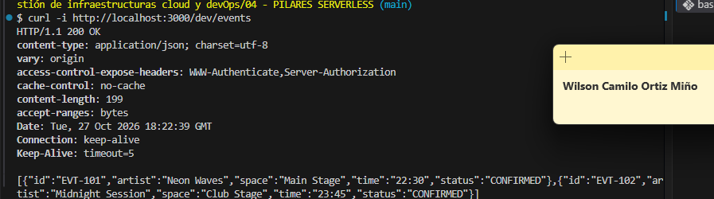
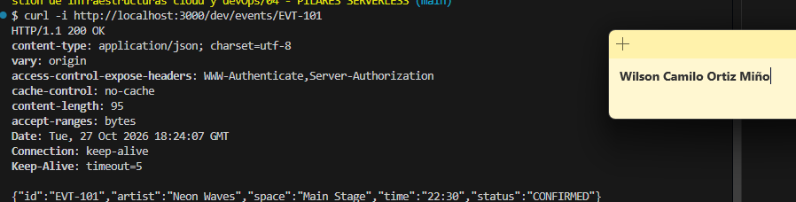
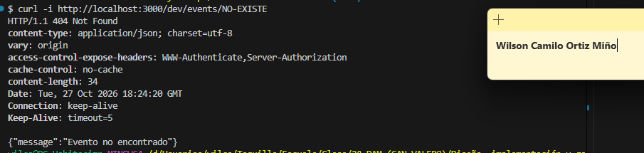

POST y PUT:

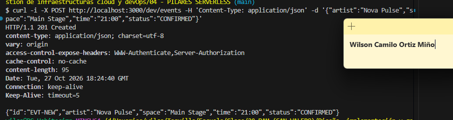
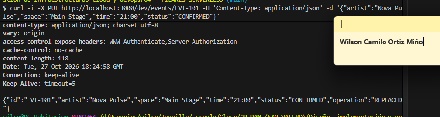

PATCH y DELETE:

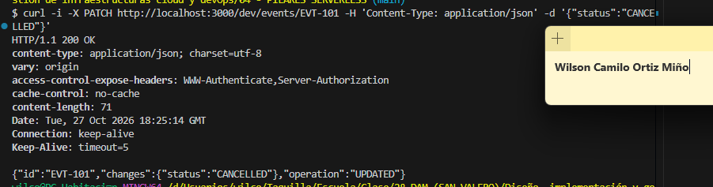
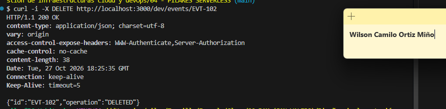

Errores y ausencia de persistencia:

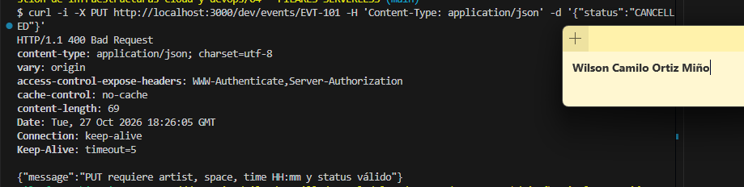
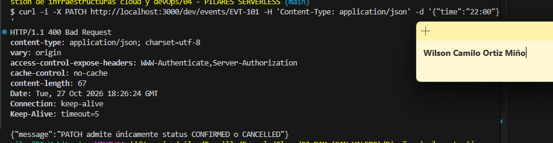
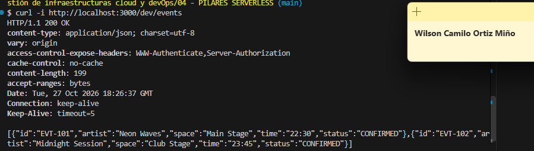

Preflight para el navegador:

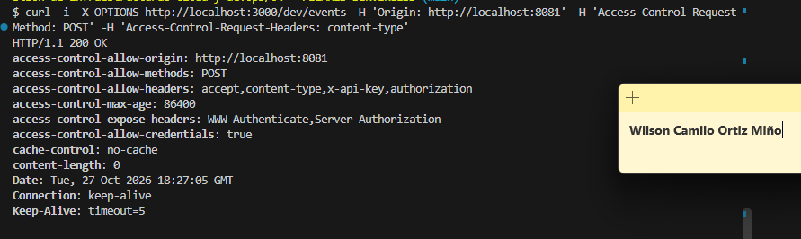

- Limitaciones del ejercicio: os dos eventos son datos fijos; POST, PUT, PATCH y DELETE solo responden y no modifican catalog. Un GET posterior conserva la lista original. No hay almacenamiento ni persistencia real; el PATCH acepta únicamente status con valores CONFIRMED o CANCELLED, y PUT exige el objeto completo.
 

# Bloque 05
 
## Resultado
- Qué añadí al proyecto: Creé la carpeta hermana mobile/ con su propio package.json (Expo SDK 54, React 19, React Native 0.81 y React Native Web, con versiones fijadas), app.json con Metro para web, tsconfig.json extendiendo expo/tsconfig.base, src/types.ts con el contrato FestivalEvent/EventInput, y App.tsx como interfaz raíz con dos tarjetas locales y un botón «Seleccionar EVT-101». También añadí al .gitignore las exclusiones de node_modules, dist, .expo, .serverless, .env y .aws. No toqué el backend ni introduje llamadas HTTP.

- Ruta o pantalla comprobada: Abrí la app en el navegador del aula con npm run web desde mobile, en la URL que indicó Expo (por defecto http://localhost:8081). Verifiqué la pantalla «Festival Control → Programación» con las dos tarjetas (EVT-101 y EVT-102) y pulsé el botón de selección. Después recargué la página para contrastar el estado inicial.

- Estado y respuesta observados: La pantalla mostró fondo negro, acentos rosas y las dos tarjetas con sus campos id · status, artist y space · time. Al pulsar «Seleccionar EVT-101», el texto inferior pasó de «Selección: ninguna» a «Selección: EVT-101». Al recargar el navegador, el texto volvió a «Selección: ninguna» y las dos tarjetas permanecieron. npm run typecheck terminó sin errores.
 
## Comprensión
- Recorrido del dato, explicado con mis palabras: App.tsx declara un array local tipado localEvents: FestivalEvent[] y lo asigna a events. El events.map(...) recorre cada elemento y dibuja una View con key={item.id}, mostrando Text con los campos del contrato. El estado de selección vive en useState<string | null>(null); el botón Pressable tiene onPress={() => setSelected('EVT-101')}, que cambia el estado y provoca un nuevo render. El texto inferior lee selected y muestra el id o «ninguna». Todo ocurre en el cliente: no hay fetch ni llamada a la API.

- Cambio guiado y resultado: En App.tsx cambié setSelected('EVT-101') por setSelected('EVT-102') y el texto del botón a «Seleccionar EVT-102». Al guardar y pulsar, el texto inferior mostró «Selección: EVT-102». Después restauré EVT-101 y la etiqueta original para conservar el hito base. Las dos tarjetas permanecieron en todo momento y no se introdujo HTTP.

- Error encontrado y cómo lo resolví: Al principio npm run web se quejó de que faltaban módulos porque no había ejecutado npm install en mobile. Lo resolví entrando en mobile con cd (comprobando con pwd que no estaba en backend ni en la raíz) y ejecutando npm install con el package.json completo ya guardado; después npm run typecheck y npm run web funcionaron. También verifiqué que el puerto 8081 estuviera libre; si estaba ocupado, acepté el puerto que propuso Expo sin cambiar API_URL, porque en este bloque todavía no hay API.
 
## Evidencias
- Captura o transcripción breve, sin credenciales:

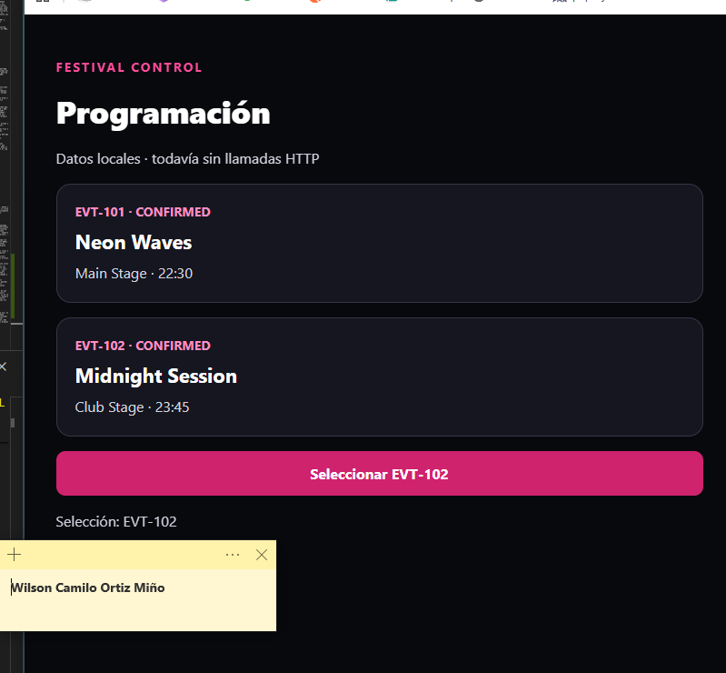

- Limitaciones del ejercicio: Los datos son un array local tipado en App.tsx; no hay llamadas de red ni backend implicado, por lo que el backend de 04 puede estar detenido. La selección es estado de interfaz y no se conserva al recargar (no hay persistencia). La vía principal es el navegador del aula con React Native Web; el teléfono con Expo Go es opcional y exigiría SDK compatible, URL LAN del PC y red permitida. Las escrituras y el fetch real llegan en los bloques 06 y 07.
 